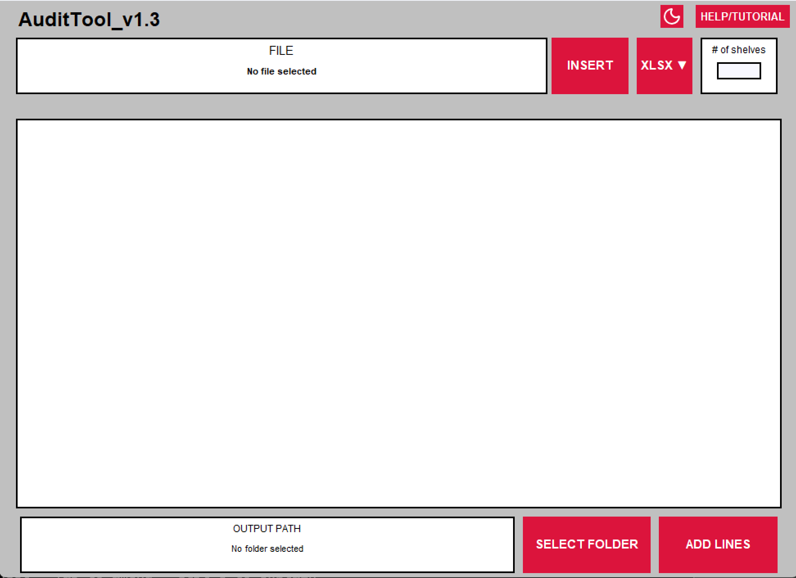

This tool was built by me to solve an issue. At my current job, IT Network Infastructure, I was given the task of documenting dataports for buildings.  

About 20 buildings into the campus network audit, I noticed one step was taking over an hour per closet: adding a row for every jack in a range and filling in what was missing. That is when I decided to make this tool, this is a go to example of me finding a problem, and creating a solution. 

AuditTool generates jack IDs from a start and end range and fills in the missing rows without overwriting anything already there, keeping jacks in order by where they are in the closet. It reads and writes CSV and Excel, has a resizable dark mode window and a built-in help tutorial, and is packaged as a Windows .exe so nobody needs Python installed. I also wrote a Knowledge Article so my teammates could use it without me.

Each closet now takes under a minute, and the team has used it on 60+ closets. This tool is used at a BIG 10 University by multiple professionals.

