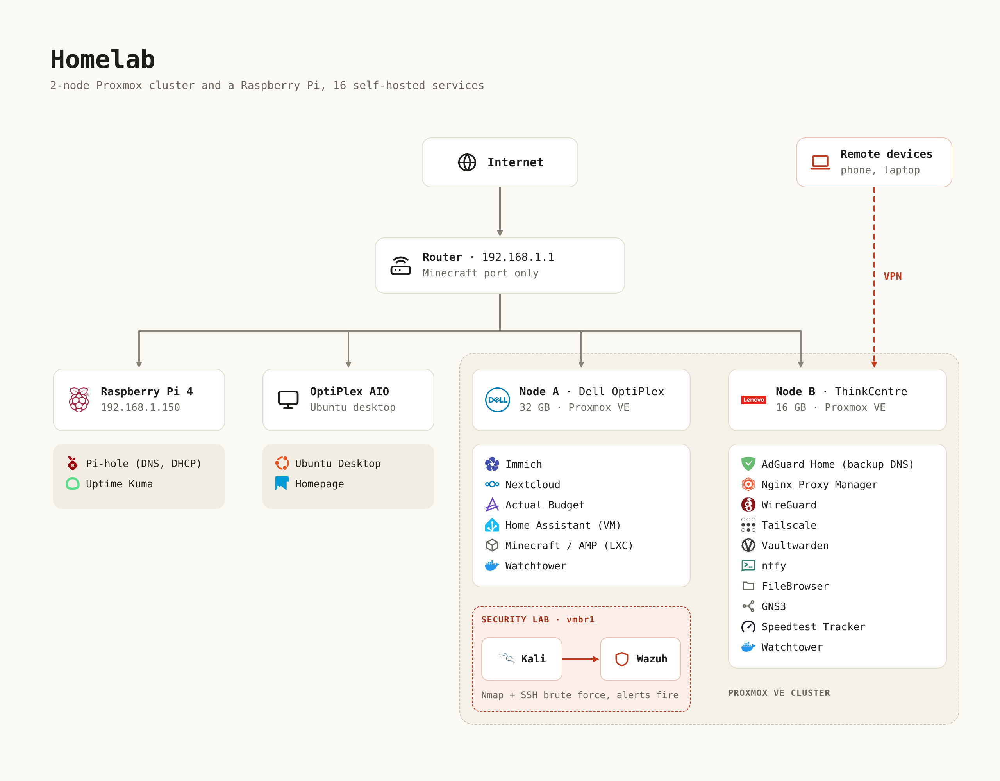

> **Note:** This diagram was generated with the help of an LLM. Temperary diagram while I am in the stage of testing and changing technology/tools used.

## Hardware
- **Node A:** Dell Optiplex, 32 GB RAM. **Node B:** Lenovo ThinkCentre, 16 GB RAM. Relevant when it came to deciding on how to split usage. If you are interested in my acquiring of the mini pcs, I searched on Facebook Marketplace to find both of these deals. 
- **Raspberry Pi 4:** Pi-hole and Uptime Kuma, kept separate so DNS and monitoring stay up when the cluster reboots.

## Design choices
- **DNS and DHCP:** Pi-hole on the Pi is the main server, and AdGuard Home on Node B is the backup DNS.
- **Monitoring:** Uptime Kuma on the Pi, with alerts through ntfy.
- **Remote access:** admin pages are only reachable over Tailscale or WireGuard. The only public port is the Minecraft server, with a whitelist.
- **Filtering:** per-device Pi-hole groups, including blocking DNS-over-HTTPS so filtering can't be bypassed. I check it with Pi-hole's query logs and Wireshark captures.
- **Security lab:** an internal-only Proxmox bridge with a Kali VM and Wazuh. I run Nmap scans and SSH brute-force tests and make sure the alerts fire.

## What it doesn't do
The two nodes are only clustered so I can manage both from one login. There is no shared storage or high availability. I plan to get a proper NAS set up and look into adding Jellyfin to my services, but NAS's are pretty dang expensive and I am a college student...

If you want to talk more about this project or give me some advice, please reach out to me! I am extremely passionate about learning and self-hosting services.