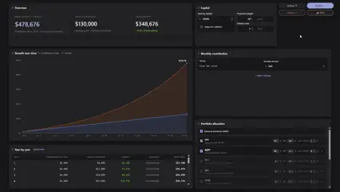

> **Note:** I made this for my own use, and it doubled as a way for me to learn agentic workflows.

I wanted a quick budgeting and projection tool that had every feature I would actually use, so I just built one. It runs entirely in the browser with no backend, no build step, and no account, so all you have to do is open the page.

## Features
- **Investment projection:** compound growth with optional dividend reinvestment (DRIP), custom contribution phases, an inflation-adjusted view, and a year-by-year table (with CSV export) and chart. Any ETF or stock can be added, using a built-in table of long-run historical returns or your own estimate.
- **Budget tracker:** income, expenses, and savings, with a customizable color-coded pie chart.
- **Layout:** draggable, resizable widgets that snap to a grid, and 15 built-in themes.
- **Backups:** one-click JSON backup and restore, so you can move between devices and pick up where you left off.

## Privacy
Everything is saved in the browser's `localStorage`, so nothing ever gets sent anywhere. The JSON backup is there because clearing your browser data would otherwise wipe everything.

## How I built it
I used this project to learn agentic workflows. Some changes to the repo get shipped by a small multi-agent pipeline. First, an architect agent drafts a plan. Then, an engineer agent implements it, and a QA agent reviews and fixes it. Finally, the pipeline commits, pushes, and opens a pull request under a bot account.
